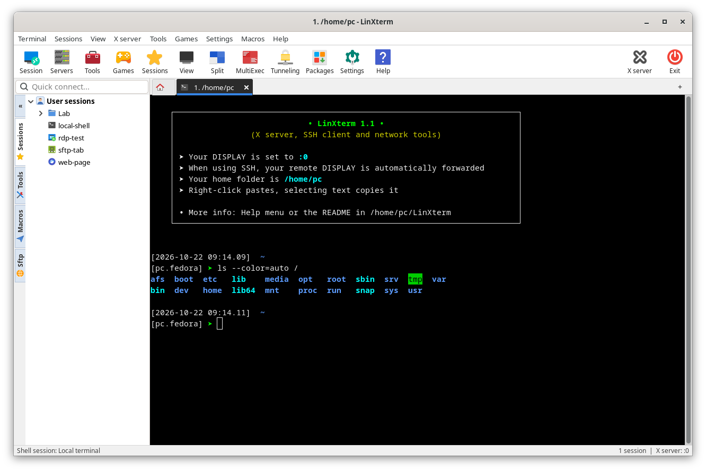

# LinXterm

Terminal tout-en-un pour Linux inspiré de l'interface et des fonctionnalités de
MobaXterm : client SSH à onglets avec navigateur SFTP, X11-forwarding, RDP, VNC,
Telnet, FTP, port série, outils réseau, serveurs, tunnels SSH, macros, MultiExec…

Écrit en **Object Pascal** (Free Pascal, le langage de Delphi utilisé par MobaXterm),
avec GTK 3 pour l'interface et VTE comme moteur de terminal (comme MobaXterm s'appuie
sur le moteur C de PuTTY).

> Projet indépendant, sans lien avec Mobatek. MobaXterm est une marque de Mobatek, citée
> uniquement pour décrire l'inspiration et la compatibilité (import des sessions).

**Site de présentation (français / English) : https://joss943.github.io/linxterm/**



## Présentation

LinXterm réunit dans une seule fenêtre tout ce qu'il faut pour travailler sur des machines
à distance, sans jongler entre une dizaine d'outils :

- **Terminaux à onglets** : terminaux locaux (bash, zsh…) et distants, onglets numérotés,
  détachables et colorables, vue partagée (2 ou 4 terminaux, mosaïque) et **MultiExec**
  pour taper la même commande dans plusieurs serveurs à la fois.
- **Sessions enregistrées** : SSH, Telnet, Mosh, RDP, VNC, FTP, SFTP, port série, shell local,
  explorateur de fichiers et navigateur web, rangées en dossiers. Les mots de passe sont gardés
  dans le trousseau du bureau. Un dossier entier s'ouvre en un clic, et les sessions existantes
  s'importent depuis MobaXterm, OpenSSH (`~/.ssh/config`), PuTTY ou Remmina.
- **SSH complet** : X11-forwarding (les applications graphiques du serveur s'affichent sur votre
  bureau), passerelle de rebond, clés privées, reconnexion automatique, **navigateur SFTP** qui
  suit le dossier du terminal et barre de surveillance du serveur (CPU, RAM, disque, réseau).
- **Outils intégrés** : scanner réseau et de ports, ping graphique, traceroute, ports ouverts,
  Wake-on-LAN, calculatrice de sous-réseau, générateur de clés SSH, éditeur de texte,
  comparaison de fichiers et de dossiers, liste des processus.
- **Serveurs en un clic** (HTTP, FTP, TFTP, SSH, iperf3) pour échanger des fichiers sur le
  réseau local, et **tunnels SSH** (redirections locales, distantes, SOCKS) gérés graphiquement.
- **Confort** : macros, palette de commandes (Ctrl+Maj+P), coloration des mots-clés (erreurs en
  rouge, avertissements en orange), journaux de session, notification à la fin des commandes
  longues, liens et adresses IP cliquables, thème clair, sombre ou automatique.

## Distributions compatibles

LinXterm fonctionne sur **Linux x86_64** avec **GTK 3.24** et **VTE 0.76 ou plus récent**, sous
X11 comme sous Wayland (GNOME, KDE Plasma, Xfce, Cinnamon…).

| Distribution | Versions | État |
|--------------|----------|------|
| Fedora | 40 et suivantes | **testé** (Fedora 44, GNOME) |
| Ubuntu, Kubuntu, Xubuntu… | 24.04 LTS et suivantes | compatible, non testé |
| Linux Mint, Pop!_OS, Zorin OS | versions basées sur Ubuntu 24.04 | compatible, non testé |
| Debian | 13 « trixie » et suivantes | compatible, non testé |
| Arch Linux, Manjaro, EndeavourOS | à jour | compatible, non testé |
| openSUSE | Tumbleweed, Leap 16 | compatible, non testé |
| RHEL, AlmaLinux, Rocky Linux | 10 | compatible, non testé (Free Pascal à installer depuis freepascal.org) |

**Non compatibles** (VTE trop ancien) : Debian 12, Ubuntu 22.04, Linux Mint 21, RHEL / Alma /
Rocky 9, openSUSE Leap 15. Les processeurs ARM (Raspberry Pi…) ne sont pas pris en charge.

## Installation

**1. Installer le compilateur Free Pascal** (GTK 3 et VTE sont déjà présents sur les bureaux
courants ; aucun paquet de développement n'est nécessaire) :

| Distribution | Commande |
|--------------|----------|
| Fedora | `sudo dnf install fpc gtk3 vte291` |
| Ubuntu, Debian, Mint | `sudo apt install fpc libgtk-3-0 libvte-2.91-0` |
| Arch, Manjaro | `sudo pacman -S fpc gtk3 vte3` |
| openSUSE | `sudo zypper install fpc libgtk-3-0 libvte-2_91-0` |

**2. Télécharger et installer LinXterm** (sans droits administrateur : le programme reste dans
son dossier, avec un lanceur dans le menu des applications et sur le Bureau) :

```bash
git clone https://github.com/Joss943/linxterm.git
cd linxterm
./install.sh
```

**3. Outils facultatifs**, utilisés par certaines fonctions s'ils sont installés :

| Fonction | Programmes ou bibliothèques |
|----------|-----------------------------|
| SSH, SFTP, tunnels | `ssh`, `sftp` (OpenSSH), `sshpass`, `mosh` |
| Bureau à distance RDP | FreeRDP 3 (`xfreerdp3` ou `sdl-freerdp3`) |
| VNC dans un onglet | GTK-VNC (`libgtk-vnc-2.0`) |
| Navigateur web intégré | WebKitGTK 4.1 |
| Coloration syntaxique de l'éditeur | GtkSourceView 4 |
| Mots de passe dans le trousseau | libsecret (GNOME Keyring, KWallet) |
| Outils réseau | `nmap`, `traceroute`, `iperf3` |
| Comparaison, processus | `meld` ou `kdiff3`, `htop` |

Si un outil manque, LinXterm le signale. Le bouton **Packages** de la barre d'outils montre ce
qui est installé et installe le reste (dnf, apt ou pacman).

## Prise en main

1. **Ouvrir un terminal local** : bouton *Start local terminal* de l'onglet d'accueil (ou
   Entrée, ou Ctrl+Maj+T).
2. **Se connecter tout de suite** : tapez `utilisateur@serveur` (ou `rdp serveur`,
   `vnc serveur`, `sftp serveur`…) dans **Quick connect**, en haut à gauche, puis Entrée. Le
   même champ filtre vos sessions enregistrées et propose des suggestions.
3. **Enregistrer une session** : bouton **Session** de la barre d'outils, choisissez le type
   (SSH, RDP…), saisissez le serveur et l'utilisateur, puis *OK*. La session apparaît dans
   l'onglet **Sessions** du panneau latéral : double-clic pour l'ouvrir, clic droit pour la
   modifier, la dupliquer, la ranger dans un dossier ou ouvrir tout un dossier.
4. **Transférer des fichiers** : à l'ouverture d'une session SSH, l'onglet **Sftp** du panneau
   latéral affiche les fichiers du serveur. Glissez-déposez pour envoyer ou télécharger ;
   *Follow terminal folder* suit le dossier courant du terminal.
5. **Lancer une application graphique distante** : avec *X11-Forwarding* coché (par défaut),
   tapez par exemple `gedit` dans le terminal SSH, et la fenêtre s'ouvre sur votre bureau.
6. **Travailler sur plusieurs serveurs** : **Split** affiche 2 ou 4 terminaux côte à côte ;
   **MultiExec** envoie ce que vous tapez à tous les terminaux affichés (case *Receive input*
   pour en exclure un).
7. **Tunnels, serveurs, outils** : boutons **Tunneling** et **Servers** de la barre d'outils,
   onglet **Tools** du panneau latéral.
8. **Retrouver une commande** : Ctrl+Maj+P ouvre la palette ; tapez quelques lettres d'une
   session, d'un onglet ou d'une commande de menu.
9. **Personnaliser** : **Settings** (police, couleurs, invite, journaux, SSH, notifications…)
   et *View > Skin* (clair, sombre ou automatique).

## Lancer

- Icône **LinXterm** sur le Bureau, ou menu des applications ;
- en ligne de commande : `linxterm` (options : `--local`, `--ssh user@hote[:port]`,
  `--session <nom ou id>`, `--edit <fichier>`).

## Interface (celle de MobaXterm, modernisée)

- Barre de menus : Terminal, Sessions, View, X server, Tools, Games, Settings, Macros, Help.
- Grande barre d'outils : Session, Servers, Games, View, Split, MultiExec, Tunneling,
  Packages, Settings, Help … X server.
- **Aucun bouton en double** : *Sessions* et *Tools* sont les onglets du panneau latéral, on
  quitte par la croix de la fenêtre (ou *Terminal > Exit*, Ctrl+Maj+Q), un terminal local
  s'ouvre depuis l'onglet d'accueil (ou Ctrl+Maj+T), la recherche se fait dans le Quick
  connect ; dans les menus, chaque commande n'apparaît qu'une fois.
- Champ **Quick connect** : filtre les sessions, ou se connecte directement
  (`user@hote`, `telnet hote 23`, `rdp hote`, `vnc hote`, `ftp hote`, `sftp hote`…), avec
  **autocomplétion** : sessions enregistrées, connexions récentes, alias de `~/.ssh/config` et
  hôtes de `~/.ssh/known_hosts` (plusieurs mots possibles : « lab web »).
- Barre latérale à onglets verticaux : **Sessions** (arbre « User sessions » avec dossiers,
  glisser-déposer, menus contextuels), **Tools**, **Macros**, **Sftp**.
- Onglet d'accueil : « Start local terminal » (Entrée), « Recover previous sessions » et
  sessions récentes en un clic.
- Onglets numérotés (`1. /home/pc`, `2. serveur`…), détachables dans une fenêtre,
  renommables, dupliquables ; « Session stopped – Press R to restart » à la fin d'une session.
- **Couleur d'onglet** par session (*Bookmark settings > Tab color* : rouge pour la production…).
- **Activité** : l'onglet d'un terminal en arrière-plan qui affiche du nouveau texte passe en
  bleu gras (une sonnerie fait aussi clignoter la fenêtre dans la barre des tâches).
- **Palette de commandes** (Ctrl+Maj+P) : tapez quelques lettres pour ouvrir une session,
  aller à un onglet, lancer n'importe quelle commande des menus ou se connecter à `user@hote`.
- Terminal local avec l'invite de MobaXterm (désactivable dans *Settings > Configuration > Terminal*) :
  ```
  [2024-10-22 14:12.42]  ~/projets
  [pc.fedora] ➤
  ```
  (flèche verte, ou rouge si la commande précédente a échoué).
- Thème clair (classique), sombre ou **automatique** (suit le mode clair / sombre du bureau
  GNOME, en direct) ; marges intérieures du terminal, onglet actif souligné, survols.
- Style modernisé, mêmes règles dans les deux thèmes : menus et barre d'outils d'un seul
  tenant, coins arrondis, survols discrets, onglet latéral actif marqué d'un trait bleu, onglet
  actif relié à son contenu (sombre au-dessus d'un terminal, clair au-dessus de l'accueil).

## Types de sessions (fenêtre « Session settings »)

| Type | Implémentation |
|------|----------------|
| SSH | OpenSSH, mot de passe/phrase de passe enregistrés et saisis automatiquement, X11-forwarding, rebond (jump host), clé privée, commande distante, compression, keepalive, options expertes |
| Telnet | client Telnet intégré (négociation complète, connexion automatique) |
| RDP | FreeRDP (fenêtre dédiée), redimensionnement dynamique, presse-papier, partage du dossier personnel, son |
| VNC | visionneuse **intégrée dans l'onglet** (GTK-VNC), mise à l'échelle, lecture seule, Ctrl+Alt+Suppr, capture |
| FTP | client FTP intégré (passif / actif, MLSD/LIST), gestionnaire de fichiers double volet |
| SFTP | gestionnaire de fichiers double volet (local / distant) |
| Serial | terminal série intégré (vitesse, bits, parité, stop, contrôle de flux) |
| File | gestionnaire de fichiers local |
| Shell | terminal local (bash, zsh… au choix) |
| Browser | navigateur web intégré (WebKitGTK) |
| Mosh | si `mosh` est installé (bouton Packages) |

## Navigateur SFTP (panneau « Sftp »)

S'ouvre automatiquement à la connexion SSH, **sans redemander le mot de passe**
(réutilisation de la connexion SSH du terminal). Envoi / téléchargement de fichiers et
de dossiers (glisser-déposer depuis le gestionnaire de fichiers), création, renommage,
suppression, droits (chmod), ouverture et **édition d'un fichier distant** (renvoyé
automatiquement à chaque enregistrement), **« Follow terminal folder »** (suit le dossier
du shell distant) et **« Remote monitoring »** : barre en bas du terminal avec icônes et
jauges (CPU, RAM, réseau ▼/▲, disque, utilisateurs, uptime) comme MobaXterm.

## Coloration syntaxique

Comme la « Syntax highlighting » de MobaXterm, les mots-clés de la sortie des terminaux sont
colorés : **erreurs en rouge** (`error`, `failed`, `fatal`, `denied`, `refused`, `erreur`,
`échec`…), **avertissements en orange** (`warning`, `deprecated`, `timeout`, `inactive`…),
**succès en vert** (`OK`, `success`, `done`, `active`, `running`, `réussi`…).

- Le texte déjà coloré par un programme (`ls`, `grep`, `git`, `systemctl`…) et les programmes
  plein écran (vi, top, less…) ne sont pas modifiés ; `error.log` ou `/var/log/error` non plus.
- Réglage global : *Settings > Configuration > Terminal* (activé par défaut) ; par session :
  *Terminal settings > Syntax highlighting* ; pour l'onglet en cours : clic droit >
  *Syntax highlighting* (sans redémarrer la session).

## Journaux de session (logs)

Comme l'option « Log terminal output » de MobaXterm : *Settings > Configuration > Terminal >
Session logs* pour toutes les sessions, ou *Terminal settings > Log the terminal output* pour
une seule session. Les journaux sont du texte brut, dans `~/Documents/LinXterm/logs`
(dossier modifiable), un fichier par session (`nom_AAAAMMJJ_HHMMSS.log`, droits 0600) :

```
==== LinXterm 1.3 - SSH session to root@10.0.0.12 - started 2026-10-22 14:45:40 ====
[2026-10-22 14:45:41] root@web:~$ systemctl restart nginx
[2026-10-22 14:45:43] root@web:~$
```

Couleurs et séquences d'échappement retirées, corrections au clavier appliquées, programmes
plein écran (vi, top, less…) ignorés, horodatage optionnel ; une session redémarrée continue
dans le même fichier. Menu *Terminal > Open the session logs folder* et clic droit
*Open the session log*.

## Import des sessions

*Sessions > Import sessions* : reprenez vos sessions existantes,
classées dans un dossier par origine, sans doublon si vous importez deux fois :

- **MobaXterm** : fichier `.mxtsessions` (*Sessions > Export sessions* sous Windows) ou
  `MobaXterm.ini` — SSH (utilisateur, port, X11, compression, commande, passerelle, clé),
  Telnet, RDP, VNC, FTP, SFTP, Serial, Shell, Browser, Mosh, avec l'arborescence des dossiers ;
- **OpenSSH** : les `Host` de `~/.ssh/config` (connexion par l'alias : toutes les options du
  fichier s'appliquent) ;
- **PuTTY** (`~/.putty/sessions`) et **Remmina** (RDP, VNC, SSH, SFTP avec les groupes).

Les mots de passe ne sont jamais importés.

## Autres fonctions

- **Reconnexion automatique** : quand une connexion SSH est perdue (réseau, serveur
  redémarré…), compte à rebours puis reconnexion (jusqu'à 10 essais espacés de 3 à 30 s ;
  R : maintenant, Échap : annuler). Désactivable dans *Settings > Configuration > SSH*.
- **Collage sécurisé** : confirmation avec aperçu avant de coller plusieurs lignes dans un
  terminal (chaque retour à la ligne pourrait lancer une commande).
- **Split** (2 verticaux, 2 horizontaux, 4, mosaïque) et **MultiExec** (bandeau jaune :
  ce que vous tapez part dans tous les terminaux). Les tuiles vides proposent « Start local
  terminal » / « Open a session… », et les terminaux restent dans leur tuile quand un onglet
  se ferme. En MultiExec, la case **Receive input** de chaque tuile exclut un terminal (grisé) :
  il ne reçoit plus la saisie des autres et ce qu'on y tape reste local.
- **Ouvrir un dossier entier** (clic droit sur un dossier de sessions) :
  *Open all*, *Open all in split view* ou *Open all in MultiExec* — seuls les terminaux de ce
  dossier sont affichés et reçoivent la saisie (idéal pour un cluster de serveurs).
- **Notifications de bureau** quand LinXterm n'est pas au premier plan : fin d'une commande
  longue (10 s par défaut) avec son code de retour, dans les terminaux locaux et — avec
  *Follow terminal folder* — dans les shells bash/zsh distants ; sonnerie (bip) d'un terminal.
  Un clic sur la notification affiche l'onglet. Réglages : *Settings > Configuration > Terminal*.
- **Liens et adresses dans le terminal** : Ctrl+clic sur une URL l'ouvre ; Ctrl+clic sur une
  adresse IP (avec port éventuel) propose SSH, SFTP, RDP, VNC, Telnet, ping, navigateur ou
  copie ; mêmes actions en tête du menu Ctrl+clic droit.
- **Macros** : enregistrement des frappes, lecture, édition, raccourcis Ctrl+Maj+F1…F12 et
  Alt+Maj+F1…F12 (sous Linux, Ctrl+Alt+F1…F12 changent de console virtuelle), macro exécutée
  au démarrage d'une session.
- **Tunneling** (*SSH tunnels*) : redirections locales, distantes et dynamiques (SOCKS),
  éditeur graphique, démarrage automatique.
- **Servers** : serveurs HTTP, FTP, TFTP, SSH/SFTP (sshd en mode utilisateur), iperf3.
- **Tools** : éditeur de texte avec coloration syntaxique, générateur de clés SSH,
  comparaison de fichiers et de dossiers, scanner réseau, scanner de ports, ping graphique,
  traceroute, ports ouverts, processus, moniteur système, Wake-on-LAN, calculatrice IP…
- **Games** : Mines, 2048, Flood.
- **Packages** : installe les outils optionnels avec `dnf` / `apt` / `pacman`.
- **X server** : utilise le serveur X du bureau (Xwayland / Xorg) pour le X11-forwarding.
- Mots de passe stockés dans le **trousseau GNOME** (libsecret).

## Sécurité

- **Mots de passe** : dans le trousseau GNOME (chiffré). Sans trousseau, ils ne sont **jamais
  écrits sur le disque** (demandés à chaque connexion) sauf si vous autorisez le fichier
  obfusqué (*Settings > Configuration > Misc*) ; ceux d'un ancien fichier passent dans le
  trousseau dès qu'il est disponible. Transmis à ssh par un fichier à usage unique (0600, dossier
  privé 0700, création exclusive), à FreeRDP 3 par l'environnement privé du processus.
- **Injection d'options** refusée : un nom d'hôte, d'utilisateur ou de passerelle qui commence
  par `-` ou contient des caractères du shell (session importée, Quick connect, lien) ne peut
  pas devenir une option de ssh, mosh ou FreeRDP (`-oProxyCommand=…`).
- **Import** : les commandes locales et options expertes (ssh / FreeRDP) d'un fichier de
  sessions reçu sont supprimées et signalées : ouvrir une session importée n'exécute rien sur
  votre ordinateur.
- **Liens du terminal** : seuls http(s), ftp et mailto s'ouvrent dans le navigateur ; ssh://,
  sftp://, rdp://, vnc://, telnet:// ouvrent une session (après les mêmes vérifications) ;
  `file://` seulement depuis un terminal local et après confirmation ; les liens OSC 8 (dont le
  texte peut masquer la vraie cible) demandent confirmation en affichant l'adresse réelle ;
  `javascript:`, `data:`… sont refusés.
- **Serveurs** : les fichiers et dossiers cachés (`.ssh`, `.gnupg`, `.env`…) ne sont jamais
  servis ni modifiables (HTTP, FTP, TFTP), les `../` et liens symboliques sortant du dossier
  sont refusés, et partager tout le dossier personnel ou `/` demande confirmation.
- Collage de plusieurs lignes confirmé, journaux en 0600 dans un dossier privé, identifiants et
  noms de fichiers secrets tirés de `/dev/urandom`, fichiers temporaires dans le dossier privé,
  raccourcis de bureau protégés contre les noms piégés, certificats RDP en *trust on first use*.

## Confidentialité et RGPD

LinXterm ne collecte aucune donnée personnelle et ne transmet rien à son auteur.

- **Aucune collecte** : pas de compte, de télémétrie, de statistiques ni de publicité. LinXterm ne
  contacte aucun serveur de lui-même : uniquement les machines que vous ouvrez et, à votre demande,
  les dépôts de votre distribution (*Packages*).
- **Données locales** : réglages, sessions, macros, tunnels, serveurs, sessions récentes et onglets
  à rouvrir dans `~/.config/linxterm/`, fichiers lisibles par vous seul.
- **Mots de passe** : dans le trousseau du bureau (« LinXterm password »), jamais en clair, jamais
  exportés ni importés ; fichier masqué seulement si vous l'activez faute de trousseau.
- **Journaux de session** : désactivés par défaut ; une fois activés, dans
  `~/Documents/LinXterm/logs` (dossier privé). Ils peuvent contenir des données personnelles
  affichées dans les terminaux : supprimez-les quand ils ne servent plus.
- **Site web** : aucun cookie ni mesure d'audience ; seul le choix de langue est gardé dans le
  navigateur. Hébergement GitHub Pages (données techniques selon la déclaration de confidentialité
  de GitHub).
- **Vos droits** : l'auteur ne détient aucune donnée vous concernant. En entreprise, votre
  organisation reste responsable des données traitées avec LinXterm. Questions : issues GitHub.

Tout effacer : `rm -rf ~/.config/linxterm ~/Documents/LinXterm/logs`, puis supprimer les entrées
« LinXterm password » dans *Mots de passe et clés* (Seahorse) ou KWallet.

## Raccourcis clavier

| Raccourci | Action |
|-----------|--------|
| Ctrl+Shift+T | nouveau terminal local |
| Ctrl+Shift+N | nouvelle session |
| Ctrl+Shift+Q | quitter LinXterm |
| Ctrl+Shift+W | fermer l'onglet |
| Ctrl+Shift+D | dupliquer l'onglet |
| Ctrl+PgUp / PgDn | onglet précédent / suivant |
| Ctrl+Shift+C / V, Shift+Inser | copier / coller |
| Ctrl+Shift+F | rechercher dans le terminal |
| Ctrl + / - / 0, Ctrl+molette | taille de la police |
| Ctrl+Shift+P | palette de commandes (sessions, onglets, commandes) |
| Ctrl+Shift+B | afficher / masquer le panneau latéral |
| F11 | plein écran |
| Clic droit | coller (Ctrl+clic droit : menu contextuel) |
| Ctrl+clic | ouvrir un lien ; sur une adresse IP : SSH, RDP, VNC, ping… |

## Compiler

```
./build.sh      # compile bin/linxterm et les auxiliaires
./install.sh    # compile + menu des applications + raccourci sur le Bureau
```

Compilateur : Free Pascal 3.2 (testé avec 3.2.3). `build.sh` utilise la variable `FPCDIR`
si elle est définie, sinon `~/.local/opt/fpc`, sinon le paquet `fpc` de la distribution ; il
trouve seul les bibliothèques selon l'arborescence (Fedora/openSUSE, Debian/Ubuntu, Arch).
Aucune bibliothèque de développement n'est nécessaire : seules les bibliothèques
d'exécution GTK 3 / VTE sont utilisées.

## Organisation du code (`src/`)

| Fichier | Rôle |
|---------|------|
| `linxterm.lpr` | programme principal |
| `lxmainwin.pas` | fenêtre principale, menus, barre d'outils, onglets, Split, MultiExec |
| `lxterminal.pas` | onglets terminal (VTE), SSH, bannière, monitoring distant, Follow SSH path |
| `lxsessiondlg.pas` | fenêtre « Session settings » |
| `lxsessionpanel.pas` | arbre « User sessions » |
| `lxconfig.pas` | paramètres, sessions, mots de passe |
| `lxbrowser.pas`, `lxfs.pas`, `lxsftp.pas`, `lxftp.pas` | navigateur de fichiers, SFTP v3, FTP |
| `lxsftppanel.pas`, `lxfiletab.pas` | panneau Sftp, onglets SFTP/FTP/File |
| `lxremote.pas` | onglets VNC, RDP, navigateur web |
| `lxtools.pas`, `lxeditor.pas`, `lxservers.pas`, `lxtunnels.pas` | outils, éditeur, serveurs, tunnels |
| `lxmacros.pas`, `lxgames.pas`, `lxpackages.pas`, `lxsettingsdlg.pas` | macros, jeux, paquets, configuration |
| `lximport.pas` | import des sessions MobaXterm, OpenSSH, PuTTY, Remmina |
| `lxaskpass.lpr`, `lxtelnet.lpr`, `lxserial.lpr` | auxiliaires (mot de passe SSH, Telnet, série) |
| `lxrelay.lpr` | relais pseudo-terminal des sessions : coloration des mots-clés, log texte |
| `lxgtk.pas`, `lxdyn.pas` | liaisons Pascal vers GTK 3, VTE, GTK-VNC, WebKit, GtkSourceView, libsecret |
| `../share/linxterm.bashrc` | invite de commande MobaXterm des terminaux locaux (lit d'abord `~/.bashrc`) |

## Configuration

Dans `~/.config/linxterm/` : `settings.json`, `sessions.json`, `macros.json`,
`tunnels.json`, `servers.json`. Les mots de passe ne sont jamais écrits dans ces fichiers
(trousseau GNOME), ni exportés avec les sessions.

## Historique

### 1.3.1
- les icônes de l'interface sont livrées avec LinXterm : affichage identique sur tous les
  ordinateurs, même sans le thème Papirus.

### 1.3
Interface :
- aucun bouton en double : *Sessions*, *Tools* et *Exit* retirés de la barre d'outils (onglets
  du panneau latéral, croix de la fenêtre), bouton « + » des onglets, recherche et liens de
  l'accueil retirés ; dans les menus, chaque commande n'apparaît qu'une fois ;
- style modernisé dans les deux thèmes : menus et barre d'outils d'un seul tenant, coins
  arrondis, survols discrets, onglet latéral actif marqué d'un trait bleu, onglet actif relié à
  son contenu (sombre sur un terminal, clair sur l'accueil), accueil en cartes, arbre des
  sessions plus aéré ;
- accueil : Entrée lance un terminal local, aide quand la liste des sessions récentes est vide ;
- Ctrl+Maj+Q dans la liste des raccourcis ;
- libellés sans la marque MobaXterm (*SSH tunnels*, thème de couleurs *Classic*, invite
  *Two-line prompt*), les anciens réglages étant repris automatiquement.

Compilation et documentation :
- `build.sh` trouve Free Pascal et les bibliothèques sur Fedora / openSUSE, Debian / Ubuntu et
  Arch, avec un message clair s'il manque quelque chose ;
- README détaillé (présentation, distributions compatibles, installation, prise en main),
  rubrique confidentialité et RGPD ;
- site de présentation en français et en anglais : https://joss943.github.io/linxterm/ ;
- code publié sous licence GPL-3.0.

### 1.2
Nouveautés :
- sécurité : refus de l'injection d'options (hôte, utilisateur, passerelle), import sans
  commandes locales ni options expertes, liens du terminal filtrés (et confirmés pour OSC 8),
  serveurs sans fichiers cachés, mots de passe jamais écrits sans trousseau (sauf option),
  aléa cryptographique, fichier temporaire du navigateur SFTP dans le dossier privé ;
- visuel : thème automatique (clair / sombre du bureau), marges du terminal, onglet actif
  souligné, survols, page d'accueil retravaillée ;
- ouverture d'un dossier de sessions entier (onglets, Split, MultiExec limité au dossier) ;
- MultiExec : exclusion d'un terminal (case « Receive input ») ;
- autocomplétion du Quick connect (sessions, récents, `~/.ssh/config`, `known_hosts`) ;
- notifications de bureau : fin des commandes longues (locales et distantes) avec code de
  retour, sonnerie ; un clic affiche l'onglet ;
- liens cliquables (Ctrl+clic) et menu d'actions sur les adresses IP du terminal ;
- coloration syntaxique des mots-clés (erreurs, avertissements, succès), réglable globalement,
  par session et à chaud par onglet ;
- journaux de session en texte brut (global ou par session, horodatage, plein écran ignoré) ;
- import des sessions MobaXterm (`.mxtsessions`, `MobaXterm.ini`), `~/.ssh/config`, PuTTY, Remmina ;
- reconnexion SSH automatique avec compte à rebours ;
- palette de commandes Ctrl+Maj+P ;
- couleur d'onglet par session, mise en évidence des onglets actifs en arrière-plan ;
- confirmation avant de coller plusieurs lignes ; zoom de la police avec Ctrl+molette ;
- Split : boutons dans les tuiles vides, disposition conservée à la fermeture d'un onglet.

### 1.1
Corrections :
- fuite de descripteurs de fichiers avec le « Remote monitoring » (l'application pouvait
  saturer au bout d'environ 25 minutes) ;
- liste des processus vide (lecture des fichiers `/proc`), colonne utilisateur vide, tri numérique ;
- un fichier de configuration endommagé (`sessions.json`…) n'est plus écrasé : il est mis de côté
  (`*.damaged-date`) ;
- écriture des fichiers atomique (fichier temporaire puis renommage), droits et liens symboliques
  conservés, configuration en mode 0600 dès la création ;
- téléchargements SFTP/FTP via un fichier `.part` : un transfert interrompu n'abîme plus le fichier
  existant ; copie d'un fichier sur lui-même refusée ; progression du bon transfert dans la file ;
- mot de passe RDP retiré de la ligne de commande (visible par `ps`) : transmis à FreeRDP 3 par
  l'environnement privé du processus ;
- serveur FTP : rebond « FTP bounce » (commande PORT vers une autre machine) refusé ;
- arrêt d'un serveur pendant un transfert sans plantage ; `select()` remplacé par `poll()` ;
- menus contextuels libérés après usage, petites fuites mémoire corrigées ;
- reconnexion VNC pendant une session ouverte, MultiExec / Split cohérents, menus *View* et
  *Skin* synchronisés et mémorisés, dossier d'exécution privé vérifié, fichiers de mots de passe
  créés de façon exclusive, Wake-on-LAN validé, commandes FTP protégées contre les retours à la ligne.

Interface :
- barre de monitoring façon MobaXterm (icônes, jauges vert/orange/rouge) ;
- invite de commande MobaXterm dans les terminaux locaux ;
- icônes plus grandes dans « Session settings » ;
- les barres de recherche et de monitoring ne forcent plus l'élargissement de la fenêtre en mode
  Split / MultiExec.

## Licence

LinXterm est distribué sous licence GNU GPL version 3 : voir le fichier [LICENSE](LICENSE).

Les icônes de `icons/papirus/` proviennent du thème [Papirus](https://github.com/PapirusDevelopmentTeam/papirus-icon-theme)
(GPL-3.0, voir `icons/papirus/LICENSE`) : elles sont livrées avec LinXterm pour que l'interface soit
identique sur tous les ordinateurs, que Papirus y soit installé ou non.
